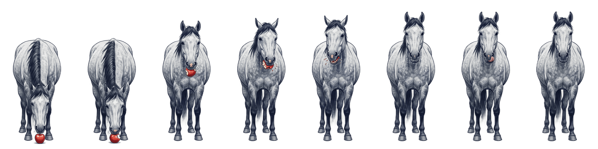

<div align="center">


# 🐎 Mare

**Um agente de IA companheiro** — pesquisa na web, escreve com rigor, gera imagens,
guarda seus projetos num kanban e ainda pastoreia um jeitinho de égua: pastando,
comendo maçã e galopando pela tela enquanto trabalha.

[](https://nextjs.org)
[](https://react.dev)
[](https://www.typescriptlang.org)
[](https://tailwindcss.com)
[](https://supabase.com)
[](https://vercel.com)

[](https://docs.npmjs.com/cli/v10/commands/npm-audit)
[](#-segurança)
[](https://mistral.ai)
[](#-contribuindo)

</div>


## ✨ O que a Mare faz

| | |
|---|---|
| 💬 **Conversa em streaming** | Respostas ao vivo, com **raciocínio visível**, fontes e chamadas de ferramenta no chat |
| 🔍 **Pesquisa real na web** | Busca e leitura de páginas via FireCrawl, com fontes exibidas e validadas na renderização |
| 🖼️ **Geração de imagens** | Tool calling de verdade: o modelo anuncia `generate_image`, o agente executa e a imagem aparece na conversa |
| 📎 **Leitura de anexos** | PDF, DOCX, XLSX, CSV, PPTX, TXT e MD — texto extraído com limites e truncamento por etapa |
| 📋 **Projetos + kanban** | Organize conversas em projetos, arraste cards e passe uma tarefa direto para a Mare executar |
| 🔐 **Login com Google** | OAuth com PKCE + sessão em cookies via Supabase (opcional em desenvolvimento local) |
| 🐴 **Pet vivo** | A égua Mare pasta, come maçã, bebe água e reage ao mouse — com sons, arrasto de guloseimas e celebrações |


## 🧠 Como ela pensa

A Mare roda um pipeline próprio (`mare-nimble`): cada resposta passa por um orquestrador
que planeja, ferramentas que coletam evidências, um escritor que redige e um validador que
confere o próprio trabalho antes de entregar.

> 💬 **pedido** → 🧭 **roteamento de skills** → 🔎 **evidências** (web_search·read_page) →
> 🗺️ **plano** do orquestrador → ✍️ **escritor** → ✅ **validação/autocorreção** → 🌊 **stream**

### As 11 skills

| Skill | Papel |
|---|---|
| `tool-orchestrator` | Decide quando acionar busca e leitura de páginas |
| `deep-research` | Investigação com múltiplas fontes |
| `fact-checker` | Checagem de dados, datas e valores |
| `reasoning-planner` | Decomposição de problemas em passos |
| `coding-engineer` | Código revisado, com contexto da pergunta |
| `image-prompt-engineer` | Prompts de imagem bem escritos, sem recusa |
| `security-auditor` | Cuidado com dados sensíveis e segredos colados no chat |
| `self-correction` | Detecta e corrige o próprio esboço |
| `error-recovery` | Degradar com elegância quando um provedor falha |
| `response-quality` | Português claro, sem enrolação |
| `context-memory` | Continuidade entre mensagens da conversa |


## 🛠️ Stack

| Camada | O quê |
|---|---|
| **Front-end** | Next.js 16 (App Router), React 19, Tailwind CSS, Motion, Lucide + LobeHub icons |
| **Back-end** | Route Handlers Node.js com proxy de IA (chaves só no servidor) |
| **IA** | Pollinations (GPT-5-nano / GPT-OSS-20B + `mai-image-2.7-flash`) e Cerebras |
| **Dados** | Supabase — Auth (Google, PKCE), Postgres com RLS, Storage para o estado |
| **Ferramentas** | FireCrawl (busca/leitura), pdf-parse, mammoth, SheetJS, JSZip, Howler |

## 🚀 Rodando localmente

> Em desenvolvimento (`npm run dev`), o **login é opcional** — a Mare conversa mesmo sem
> Supabase configurado. Só precisa das chaves de IA.

```bash
git clone https://github.com/PedroNunes0z/AgentMare.git
cd AgentMare
npm install
cp .env.example .env.local   # preencha as chaves
npm run dev
```

### Variáveis de ambiente

| Variável | Onde pegar | Pra quê |
|---|---|---|
| `NEXT_PUBLIC_SUPABASE_URL` | Supabase → Settings → API | Endereço do seu projeto |
| `NEXT_PUBLIC_SUPABASE_PUBLISHABLE_KEY` | idem | Chave pública do navegador |
| `POLLI_KEY` | [Pollinations](https://pollinations.ai) | Modelo principal + geração de imagens *(server)* |
| `CEREBRAS_API_KEY` | [Cerebras](https://cloud.cerebras.ai) | Escritor rápido do pipeline *(server)* |
| `FIRE_CRAWLER_API_KEY` | [FireCrawl](https://firecrawl.dev) | Busca e leitura de páginas *(server)* |
| `NEXT_PUBLIC_SITE_URL` | sua origem | Base do callback OAuth (`/auth/callback`) |

### Ativar o banco (Supabase)

No **SQL Editor** do seu projeto, rode na ordem:

| Ordem | Migration | Cria |
|---|---|---|
| 1️⃣ | `supabase/0001_tables.sql` | Tabelas `chats`, `messages`, `projects` |
| 2️⃣ | `supabase/0002_security.sql` | RLS, políticas, rate limit por usuário |
| 3️⃣ | `supabase/0003_storage.sql` | Bucket privado `mare-state` (sincronia entre abas) |

Pronto: login com Google habilitado no Supabase Auth → Providers.

## ☁️ Deploy na Vercel

[](https://vercel.com/new/clone?repository-url=https%3A%2F%2Fgithub.com%2FPedroNunes0z%2FAgentMare&env=NEXT_PUBLIC_SUPABASE_URL,NEXT_PUBLIC_SUPABASE_PUBLISHABLE_KEY,POLLI_KEY,CEREBRAS_API_KEY,FIRE_CRAWLER_API_KEY,NEXT_PUBLIC_SITE_URL)

Em produção o login vira **obrigatório** (fail-closed): sem Supabase configurado, o workspace
redireciona para `/login` e as rotas de IA respondem erro neutro — nada quebra aberto.


## 🔐 Segurança

Projeto auditado em **3 rodadas** de auditoria adversária (zero vulnerabilidades abertas):

- **RLS em todas as tabelas** — `auth.uid() = user_id`, com `WITH CHECK` impedindo troca de
  dono e vínculo a projeto de terceiros (anti-IDOR também no banco)
- **Chaves de IA nunca saem do servidor** — o navegador fala só com as rotas do app, que
  validam sessão com `getUser()` antes de falar com provedores
- **Rate limit por usuário** no Postgres (função RPC atômica): chat, anexos e sincronização
  têm contadores independentes
- **Anexos blindados** — extensão validada, 8 MB máx., tetos de materialização estilo
  anti mem-bomb no parse de planilhas e slides
- **CSP fechada** — sem exfiltração via imagem no Markdown, sem `eval`, frame e snippets travados
- **Cancelamento fim-a-fim** — fechar a aba ou apertar *parar* aborta as chamadas de IA na hora
- Dependências auditadas (`npm audit`: 0), erros de provedor saneados, mensagens de UI sem
  detalhes internos

## 📁 Estrutura

```text
AgentMare/
├── src/
│   ├── app/
│   │   ├── api/mare/          # chat, attachments, image, state
│   │   ├── auth/callback/     # troca PKCE do código OAuth
│   │   ├── login/             # tela de login (MagicCard)
│   │   └── mare/              # workspace (protegido)
│   ├── components/mare/       # UI do agente, do pet e do kanban
│   ├── lib/
│   │   ├── mare/              # agente, provedores, tools, rate limit
│   │   └── supabase/          # clientes + guardas de rota
│   └── proxy.ts               # proteção de rotas no servidor
├── mare-nimble/
│   ├── runtime/               # executor, orquestrador, validador, memória
│   └── skills/                # as 11 skills da Mare
├── supabase/                  # migrations (rode na ordem 1 → 3)
└── docs/                      # arte deste README
```

<div align="center">

## Bônus: a produção da arte 🎨

<details>
<summary>Folha de sprites — <i>Mare comendo maçã</i> (clique para ver)</summary>



</details>

</div>

---

<div align="center">

**Mare** · construído com 🍎, aquarela e
[](https://mistral.ai)

</div>
